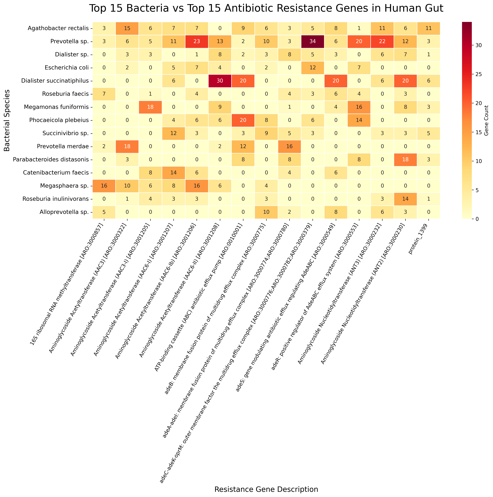

Gut Resistome Prototype  
What this is  
A prototype pipeline to map antibiotic resistance genes to specific bacterial hosts in the human gut. It takes raw metagenome-assembled genomes (MAGs), predicts the genes, and checks them against a resistance database.

How it works  
The pipeline has three steps:  

Data & Taxonomy (extract_metadata.py): Downloads 426 human gut MAGs from NCBI (BioProject PRJNA1135155) and creates a CSV mapping the genome IDs to their bacterial species. 

Gene Prediction & Search (find_resistance.py): Uses pyrodigal to predict open reading frames (ORFs) in the DNA. It translates these into proteins and uses pyhmmer to search them against the Resfams.hmm database. 

Visualization (visualize_results.py): Groups the results and plots a heatmap showing the top 15 bacteria against the top 15 resistance genes. 

Setup (Windows)  
Because HMMER and similar tools are usually built for Linux, I used the Python libraries pyhmmer and pyrodigal to run it natively on Windows.

bash 
conda create -n gut_prototype python=3.10 
conda activate gut_prototype 
pip install pyhmmer pyrodigal pandas seaborn matplotlib 
(You also need to download Resfams.hmm into this folder). 

Results
The heatmap below shows clear differences in gene distribution. For example, Dialister succinatiphilus and Prevotella carry high counts of Aminoglycoside Acetyltransferases and ABC efflux pumps. This highlights them as major resistance reservoirs in this dataset.

Limitations
Host Attribution: This script shows which resistance genes are present in a genome. It does not prove horizontal gene transfer is actively happening. That requires long-read sequencing or Hi-C.

Database: It relies on the Resfams database, which has biases. A few entries in the database also lacked text descriptions, so they show up as protein_XXXX in the final plot.

Author  
Sylvester Eyamah  
Microbiology | Public Health | Full-Stack Development